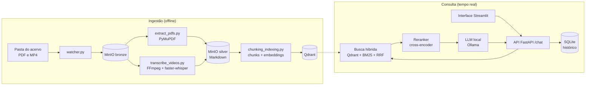

# RAG do Acervo Temático do Vale do Amanhecer

Sistema de perguntas e respostas sobre um acervo de **PDFs e vídeos**, construído com
ferramentas **100% open source** e pensado para rodar **localmente**. Você pergunta em português e recebe uma resposta baseada
**somente** nos documentos e vídeos indexados, com a **fonte citada** (arquivo e seção,
ou vídeo e minuto).

<!-- Adicione aqui uma captura de tela da interface:
 -->

## Destaques

- **Busca híbrida:** combina busca por significado (vetores) com busca por palavra-chave
  (BM25), unidas por *Reciprocal Rank Fusion*, e reordena os candidatos com um
  *reranker* treinado em português.
- **Respostas com fonte:** cada resposta cita o arquivo e a seção do PDF, ou o vídeo e o
  minuto. Se a informação não está no acervo, o sistema diz isso em vez de inventar.
- **Vídeos pesquisáveis:** o áudio é transcrito com timestamps, então a resposta aponta
  para o trecho do vídeo.
- **Ingestão automática:** um *watcher* observa uma pasta; ao chegar um PDF ou vídeo
  novo, o arquivo é enviado, processado e indexado sozinho.
- **Interface de chat** em Streamlit, com **histórico de conversas** e reescrita de
  perguntas de acompanhamento ("e a cor?").
- **Avaliação contínua** com RAGAS (usando o próprio modelo local como juiz) e registro
  dos experimentos no MLflow.
- **Vocabulário do domínio:** um glossário de sinônimos melhora a busca por termos
  específicos da doutrina.
- **Leve:** modelos pequenos escolhidos para caber em 8GB de RAM, sem nenhuma API paga.

## Como funciona



### **Ingestão** 

PDFs viram Markdown preservando títulos e descartando cabeçalhos e
rodapés repetidos. Vídeos têm o áudio extraído e transcrito com marcação de tempo. O
texto é dividido primeiro por seções e depois em trechos de cerca de 512 tokens com
sobreposição de 50; no caso dos vídeos, os trechos mantêm o minuto de início e de fim.
Cada trecho vira um vetor e é indexado no Qdrant com seus metadados.

### **Consulta**

 A pergunta é buscada de duas formas ao mesmo tempo (vetorial e BM25, esta
com a pergunta expandida pelo glossário). Os dois rankings são unidos, o *reranker*
escolhe os 4 trechos mais relevantes e o LLM local escreve a resposta usando apenas
esses trechos, citando as fontes.

## Stack

| Função | Ferramenta |
|---|---|
| Armazenamento de arquivos (bronze/silver) | MinIO (fork `pgsty/minio`) |
| Banco vetorial | Qdrant |
| Embeddings | `intfloat/multilingual-e5-small` |
| Reranking | `unicamp-dl/mMiniLM-L6-v2-pt-v2` |
| LLM (geração) | `llama3.2:3b` via Ollama |
| Transcrição | faster-whisper (Whisper) + FFmpeg |
| Extração de PDF | PyMuPDF |
| API / Interface | FastAPI / Streamlit |
| Histórico de conversas | SQLite |
| Avaliação / experimentos | RAGAS / MLflow |
| Infraestrutura local | Docker Compose |

## Pré-requisitos

- Python (testado com 3.14 no macOS, Apple Silicon)
- [Docker Desktop](https://www.docker.com/products/docker-desktop/)
- [Ollama](https://ollama.com)
- FFmpeg (`brew install ffmpeg` no macOS)
- Memória: o projeto foi desenvolvido e testado em um MacBook Air M1 com 8GB de RAM, e
  por isso usa modelos leves.

## Instalação

```bash
git clone SivansAI
cd vale-amanhecer-rag

python -m venv venv
source venv/bin/activate
pip install -r requirements.txt

cp .env.example .env     # edite: troque a senha do MinIO e defina ACERVO_DIR

ollama pull llama3.2:3b
```

O `requirements.txt` não fixa versões. Se uma biblioteca mais nova quebrar algo (as de
avaliação, como o RAGAS, costumam mudar de API), instale as versões testadas com
`pip install -r requirements-lock.txt`.

Os modelos de embedding e de reranking são baixados do Hugging Face automaticamente na
primeira execução (é preciso internet nesse momento).

## Como usar

**1. Subir o MinIO e o Qdrant**

```bash
docker compose up -d minio qdrant
```

**2. Colocar o acervo na pasta e processar.** Copie os `.pdf` e `.mp4` para a pasta
definida em `ACERVO_DIR` (nomes de arquivo únicos) e rode uma sincronização:

```bash
python data_pipeline/watcher.py --uma-vez
```

**3. Subir a API e a interface** (em dois terminais, com o `venv` ativo):

```bash
uvicorn app.main:app
streamlit run frontend/ui.py      # abre em http://localhost:8501
```

**4. Adicionar itens depois.** Deixe o vigia rodando e basta copiar arquivos novos para
a pasta do acervo:

```bash
python data_pipeline/watcher.py
```

Ele espera o arquivo terminar de ser copiado, envia ao MinIO, processa, indexa e avisa
a API. Substituir um arquivo mantendo o nome é tratado como atualização.

**5. Desligar**

```bash
docker compose down
```

Os dados continuam salvos nas pastas definidas em `MINIO_VOLUME` e `QDRANT_STORAGE`.

## API

Com a API no ar, a documentação interativa fica em `http://localhost:8000/docs`.

| Método | Rota | O que faz |
|---|---|---|
| `POST` | `/chat` | Responde uma pergunta. Com `conversa_id`, salva no histórico e reescreve perguntas de acompanhamento |
| `GET` | `/health` | Estado da API, trechos indexados, termos do glossário |
| `GET` | `/conversas` | Lista as conversas salvas |
| `GET` | `/conversas/{id}` | Abre uma conversa |
| `DELETE` | `/conversas/{id}` | Apaga uma conversa |
| `POST` | `/reindexar-bm25` | Recarrega o índice de palavra-chave depois de indexar conteúdo novo |
| `POST` | `/recarregar-glossario` | Aplica mudanças em `data_pipeline/glossario.json` sem reiniciar |

Exemplo:

```bash
curl -X POST http://localhost:8000/chat \
  -H "Content-Type: application/json" \
  -d '{"pergunta": "Sua pergunta sobre o acervo"}'
```

## Avaliação

A qualidade é medida com o [RAGAS](https://docs.ragas.io), usando o próprio modelo local
como juiz (sem chave de API), e os resultados ficam no MLflow.

1. Preencha `evaluation/gold_questions.json` com perguntas reais e as respostas
   corretas, validadas por alguém que conheça o conteúdo.
2. Com a API no ar, rode `python evaluation/evaluate_ragas.py`.
3. Veja os resultados: `mlflow ui --backend-store-uri sqlite:///mlflow.db`
   (http://localhost:5000).
4. `python evaluation/revisar_resultados.py` mostra as perguntas com pior *Context
   Precision*, boas candidatas a termos para o glossário.

Métricas: *Faithfulness* (a resposta se apoia no contexto?), *Answer Relevancy* (responde
à pergunta?) e *Context Precision* (os trechos úteis vieram primeiro?).

### Resultados

Gabarito com **10** perguntas temáticas do acervo (`evaluation/gold_questions.json`).

| Métrica | Antes do glossário | Depois do glossário |
|---|---|---|
| **Faithfulness** | 0.65 | **0.88** |
| **Answer Relevancy** | 0.63 | 0.54 |
| **Context Precision** | **1.00** | **1.00** |

**Principais observações:**
- **Fidelidade (+23 p.p.):** A *Faithfulness* saltou de **0.65** para **0.88** com o glossário ativado. A expansão de termos e sinônimos no BM25 permitiu resgatar vocabulários canônicos exatos, fornecendo trechos mais ricos e aderentes, o que aumentou a fidelidade factual da resposta gerada.

- **Precisão do Contexto (100%):** O *Context Precision* atingiu pontuação máxima (**1.00**) em ambos os cenários, comprovando a eficácia da busca híbrida (BM25 + Qdrant vetorial) unida por *Reciprocal Rank Fusion* (RRF) e reordenada pelo Cross-Encoder em posicionar a evidência certa no topo do ranking.


## Estrutura do repositório

```
.
├── app/
│   ├── main.py                 # inicialização da API
│   ├── api/endpoints.py        # rotas
│   └── core/
│       ├── rag_engine.py       # busca híbrida, reranking, prompt, chamada ao LLM
│       ├── embeddings.py       # modelo de embeddings
│       ├── qdrant_utils.py     # acesso ao banco vetorial
│       ├── bm25_index.py       # busca por palavra-chave
│       ├── reranker.py         # cross-encoder
│       ├── glossario.py        # expansão de termos do domínio
│       └── historico.py        # histórico de conversas (SQLite)
├── data_pipeline/
│   ├── watcher.py              # observa a pasta do acervo e dispara o pipeline
│   ├── extract_pdfs.py         # PDF -> Markdown
│   ├── transcribe_videos.py    # vídeo -> transcrição com timestamps
│   ├── chunking.py             # divisão em trechos
│   ├── chunking_indexing.py    # embeddings + indexação no Qdrant
│   ├── minio_utils.py          # acesso ao MinIO
│   └── glossario.json          # sinônimos de termos do domínio
├── frontend/ui.py              # interface de chat
├── evaluation/                 # RAGAS + MLflow
├── docker-compose.yml
├── docker-data/
│   └── Dockerfile
├── .env.example
└── requirements.txt
```

## Decisões técnicas

- **Modelos leves**

 Embeddings e reranker pequenos, e um LLM de 3B parâmetros, para rodar em 8GB de RAM sem GPU. A troca por modelos maiores é só mudar as variáveis no  `.env`, ao custo de mais memória.


- **BM25 separado, unido por RRF**

 O modelo de embeddings usado não gera vetores esparsos, então a busca por palavra-chave é feita à parte e combinada com a vetorial por *Reciprocal Rank Fusion*, que dispensa normalizar escalas de pontuação diferentes.


- **Glossário só no BM25**

 O embedding já generaliza variações de palavras; a busca por palavra exata é quem precisa da ajuda do glossário.


- **MinIO via fork**

 A edição comunitária oficial do MinIO foi arquivada, então o projeto usa um fork mantido pela comunidade (`pgsty/minio`).


- **MLflow com SQLite**

 O backend de arquivos do MLflow foi descontinuado nas versões  atuais; o SQLite local é o substituto mais simples.


- **Reescrita de perguntas de acompanhamento**

 A resposta continua vindo só dos trechos do acervo, não das respostas anteriores; só a pergunta é reescrita para a busca.

## Limitações

- **Qualidade limitada pelo modelo local**

    Um LLM de 3B é bem menos capaz que modelos grandes: pode resumir mal, e a reescrita de perguntas de acompanhamento às vezes falha (pode ser desligada com `REFORMULAR_PERGUNTAS=false`).


- **PDFs escaneados precisam de OCR**

    A extração lê o texto embutido no PDF; um PDF que é só imagem não gera texto. Aplique OCR antes (por exemplo com `ocrmypdf`).


- **Transcrição pode errar termos específicos**

    Principalmente nomes próprios da doutrina. O glossário ajuda na busca, mas não corrige a transcrição.


- **Índice BM25 em memória**

    Funciona bem para acervos de milhares de trechos; acervos muito maiores pediriam um índice em disco.


- **Sem autenticação**

    A API e a interface foram feitas para uso pessoal, na sua máquina. Não exponha na internet sem adicionar controle de acesso.

 

- **Formatos:**

    Somente `.pdf` e `.mp4`, em português.


- **Atualizações** 

    São detectadas pelo tamanho do arquivo, e remover um arquivo da pasta não o remove do sistema.


## Roadmap

O planejamento de evolução técnica, prioridades e estimativas de versão estão documentados em:
* 🗺️ [**ROADMAP.md**](ROADMAP.md) — Fases de desenvolvimento (v1.1, v1.2, v1.3 e v2.0).
* 💡 [**docs/SUGESTOES_DE_MELHORIAS.md**](docs/SUGESTOES_DE_MELHORIAS.md) — Detalhamento técnico, arquitetura e snippets de código para cada proposta (Streaming, Whisper `initial_prompt`, Otimização de Prompts, OCR e CI/CD).

## Aviso sobre o conteúdo

Este repositório contém **apenas código e configuração**. Nenhum documento ou vídeo do
acervo é distribuído aqui: cada pessoa usa o seu próprio material e deve ter o direito de
usá-lo. As respostas são geradas por um modelo de linguagem a partir dos trechos
recuperados e **podem conter imprecisões**: confira sempre as fontes citadas, que não são
substituídas por este sistema.

## Licença

Distribuído sob a licença MIT. Veja o arquivo [LICENSE](LICENSE). Os modelos baixados
(Llama, Whisper, embeddings, reranker) têm licenças próprias: confira os termos de cada
um antes de redistribuir ou usar comercialmente.

## Autor

Desenvolvido por **Caio Serpa** · [LinkedIn](https://www.linkedin.com/in/caioeserpa/) · [Instagram](https://www.instagram.com/caionosdados/)
